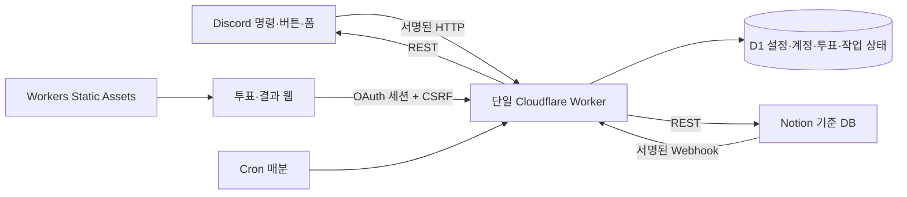

# 확인 내용과 기본 설계

확인일: 2026-11-03, Asia/Seoul.

## 실제 확인

- 지정 저장소 `discord-project-manager`에는 기존 README와 LICENSE만 있었고 작업 트리는 깨끗했습니다. 기존 LICENSE를 유지하고 README 원문은 `README.original.md`로 보존했습니다.
- 사용자 제공 Notion 페이지와 Discord 초대 링크는 웹 조회 도구에서 접근할 수 없었습니다. **DB 속성, 실제 workspace/data source ID, Discord 서버·채널·역할·권한은 미확인**입니다.
- 공개 공식 문서에서 Workers/D1 무료 한도, HTTP Interactions 응답 제한, Modal Label과 선택 컴포넌트, Notion 사용자·댓글·Webhook API를 확인했습니다. 문서에서 가능한 동작과 실제 워크스페이스의 동작은 구분합니다.
- 실제 템플릿 링크를 발급하지 않았습니다. 링크를 임의로 만들지 않았으며 스키마 명세와 초기 설정 도구를 제공합니다.

## 구조

D1은 Notion의 업무 데이터 원본을 대체하지 않습니다. 작업 생성의 중간 상태, 이슈 연결, 보고 스냅샷, 투표와 인증 정보를 저장합니다. Notion 변경 이벤트 본문을 최종 데이터로 쓰지 않고 연결된 페이지를 다시 읽습니다. 동시에 두 작업이 오래된 요약을 덮어쓰지 않도록 프로젝트 실행을 전역 lease로 직렬화하고 마지막 편집 시점을 비교합니다.

예약 작업의 id는 프로젝트·주차·작업 종류로 결정합니다. Cron은 한 번에 한 작업 단계를 처리합니다. DB 커서는 작업 재시작 이후에도 남습니다. 초기 응답이 필요한 Discord 명령은 지연 응답하고, 이슈 폼은 지원되는 Label 5개 안에서 필수 입력을 받습니다. 상세 설명은 별도 Modal, 생성은 확인 버튼으로 받습니다.

## 일정 규칙

기본 시간대 `Asia/Seoul`, 날짜는 그 시간대의 달력 날짜입니다. `week`는 대상 주 월요일입니다. 일요일에는 다음 날 월요일, 월~토에는 현재 주 월요일을 가리킵니다.

- 일요일 09:00 투표 개시를 예약합니다. 대상 역할의 봇이 아닌 사용자 전체를 REST로 페이지네이션하고 명단을 고정합니다. 조회 도중 가입·탈퇴가 있으면 API의 완전한 시점 스냅샷까지 보장되지는 않습니다.
- 대상은 해당 주 시작 시 저장된 명단입니다. 중도 가입자는 다음 주부터 참여합니다. 탈퇴/역할 상실자는 저장과 결과 조회 권한을 즉시 잃습니다(다음 API 요청에서 확인). 기존 응답은 해당 주의 역사적 스냅샷에 남습니다. 리마인더는 현재 멤버십도 다시 확인합니다.
- 09:00~23:00, 하루 28개 × 7일 = 196개. 슬롯은 `day * 28 + halfHourIndex`, 마지막은 일요일 22:30~23:00(195)입니다.
- 일요일 22:59:59를 기준으로 미응답자 DM을 예약합니다. 분 단위 Cron이므로 통상 23:00부터 처리합니다. 실제 실행은 Cron과 큐 지연을 포함합니다. 10명일 때 DM은 여러 분에 걸쳐 전송될 수 있습니다. 일요일 23:59:59 이후에는 보낸 적 없더라도 리마인더를 생략합니다.
- 빈 배열 제출은 가능한 시간 없음입니다. 행 자체가 없을 때만 미응답입니다.
- 일요일 23:59:59부터 서버 저장을 거부합니다. 마감은 Cron 상태가 아닌 서버가 저장 요청을 처리할 때 캡처한 시각으로 SQL 조건에 반영합니다.
- 마감 결과는 같은 데이터의 읽기 전용 보기입니다. 주차별 poll ID가 달라 이전 응답과 섞이지 않습니다.
- 개시 장애가 마감 전 복구되면 복구 시점 명단으로 개시합니다. 마감 후까지 개시하지 못했으면 과거 명단을 추정하지 않고 실패 기록을 남깁니다. 기존 투표는 마감 후 결과 게시를 다시 실행할 수 있습니다.

## 보고와 이슈 정책

보고서는 25개씩 끝까지 수집하고 D1에서 정렬합니다. 없는 마감은 마지막, 없는/알 수 없는 우선순위는 마지막 순위로 둡니다. Discord에는 이슈별 Embed로 속성과 담당자 프로필을 표시합니다. 필드 제한을 넘는 값은 줄이고 전체 값은 인증 웹 표로 제공합니다. 기본값은 메시지 하나당 이슈 한 개이며, Cron 게시 처리량은 분당 한 개입니다. 정식 보고 첫 메시지만 @everyone을 호출합니다. 첫 호출은 월요일 09:00에 예약되나 전체 게시 완료는 작업 수와 대기에 따라 늦어집니다.

포럼 게시물은 이미 스레드이므로 안에 중첩 스레드를 만들지 않습니다. 텍스트 모드에서는 안내 메시지와 그 메시지의 스레드 하나를 만듭니다. Notion 페이지 ID, thread ID, 첫 메시지 ID를 D1에 저장합니다. 담당자 변경은 기존 요약 메시지의 표시만 수정하고 별도 알림이나 스레드 이름 변경을 하지 않습니다.

## 접근 권한과 한계

웹 API마다 세션과 Discord 역할을 조회합니다. 타인의 투표 사용자 ID 입력은 거부하며 실제 사용자 ID는 세션에서 얻습니다. 일반 사용자는 관리자 API를 호출할 수 없습니다. 개인 Notion 토큰이나 이름·이메일 일치를 인증으로 사용하지 않습니다. 이메일은 후보 계정 조회에만 사용하며, 관리자가 Discord–Notion 쌍을 확인한 뒤 People 지정 검증에 성공해야 영구 ID 연결을 저장합니다.

Notion의 페이지별 게스트 ACL을 즉시 완전하게 검사하는 API에 의존하지 않습니다. 따라서 Notion 접근 철회는 관리자 연결 철회, 연결 해제·관리자 재확인(기본은 영구 연결), 외부 API 실패 시 중단으로 처리합니다. 모든 ACL 철회를 자동 즉시 감지했다고 보장하지 않습니다. 세부 실증 절차는 [게스트 검증](guest-verification.md)을 확인하세요.

직접 명령은 `manual-poll-open`, `manual-report`, `manual-poll-close` 작업을 생성하며, 정기 작업과 동일한 프로젝트·주차 키 및 발송 effect를 공유합니다. 따라서 먼저 실행한 경로의 결과를 재사용합니다. 명령 요청 자체는 비공개 지연 응답 후 최대 세 단계를 즉시 처리하고 나머지는 Cron이 이어갑니다. `/일정투표`는 마감이 지나지 않은 다음 주차를 열고, `/주간보고`는 호출일이 속한 주차를 사용합니다. `/투표결과`는 정식 투표만 조회하며 마감 전에는 읽기 링크만 반환합니다.
